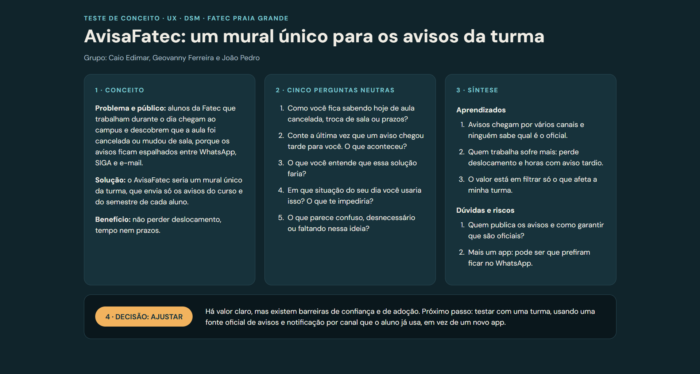

# AvisaFatec – Teste de Conceito

**Disciplina:** Experiência do Usuário (UX) · DSM · Fatec Praia Grande
**Grupo:** Caio Edimar, Geovanny Ferreira e João Pedro

## Sobre o projeto

O **AvisaFatec** é a ideia de um mural único para os avisos da turma. Hoje, os avisos de aula cancelada, troca de sala e prazos ficam espalhados entre WhatsApp, SIGA e e-mail. Quem trabalha durante o dia acaba chegando ao campus e descobrindo a mudança tarde demais.

A solução enviaria apenas os avisos do curso e do semestre de cada aluno.

## Resultado do teste de conceito

A página reúne quatro partes:

1. **Conceito:** problema, público, solução e benefício.
2. **Cinco perguntas neutras:** roteiro usado nas entrevistas.
3. **Síntese:** aprendizados, dúvidas e riscos.
4. **Decisão: AJUSTAR:** há valor claro, mas existem barreiras de confiança e de adoção. O próximo passo é testar com uma turma, usando uma fonte oficial de avisos e notificação por um canal que o aluno já usa, em vez de um novo app.

## Arquivos

| Arquivo | Descrição |
| --- | --- |
| `teste-de-conceito-avisafatec.html` | Página completa do teste de conceito |
| `testeConceito.png` | Print da página |

## Como visualizar

Abra o arquivo `teste-de-conceito-avisafatec.html` em qualquer navegador.
